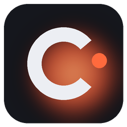
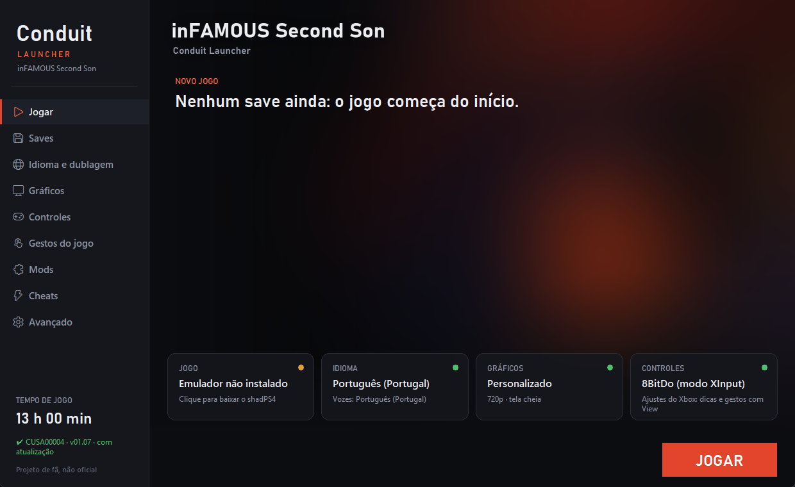

<p align="center"></p>

<h1 align="center">Conduit Launcher</h1>
<p align="center">An <b>unofficial</b> launcher for playing <b>inFAMOUS Second Son</b> (PS4) on PC with the shadPS4 emulator.</p>
<p align="center">English · <a href="README.pt-BR.md">Português</a></p>

> **Unofficial fan project.** Not affiliated with Sony Interactive Entertainment, Sucker Punch Productions
> or the shadPS4 team. **No game files come with the launcher**: you need your own copy, dumped from your
> own console. See [LEGAL.md](LEGAL.md).



## Features

- **One-click emulator setup**: "Download / update emulator" (or `baixar-emulador.bat`) fetches the
  "Infamous" shadPS4 build from its original project. Nothing else to open.
- **Separate text and voice language**: subtitles in any of the European version's 16 languages and voices
  in any of its 11. **Brazilian Portuguese** can be imported from your US copy (CUSA00223).
- **Xbox buttons in the game's hints** and **touch pad gestures on an Xbox controller** (View + button).
  The Xbox tweaks only apply with an Xbox-type controller; with a DualShock 4 / DualSense the game uses the
  controller's own touch pad and motion sensor. The controller is detected automatically, and the launcher
  asks when it can't tell.
- **"Game gestures" screen**: everything the game asks for on the touch pad and motion sensor, and what to press.
- **Saves**: automatic backup before every session, restore, .zip export/import and a save editor
  (karma, level, copy and delete slots).
- **Drag-and-drop mods**: drop a `.zip` in the `mods` folder and it is installed.
- **Cheats** you can toggle while playing, each one checked against your game's executable.
- **Patches**: skip the intro, no motion blur, no depth of field, internal resolution.
- **Graphics**: presets, FSR, sharpening, VSync, resolution.
- Steam and desktop shortcuts, play time, configurable keyboard and mouse.
- Interface in English and Portuguese (Brazil and Portugal).

## Install

1. Get the newest `.zip` from **[Releases](../../releases)** and extract it to a folder.
2. Open **Conduit Launcher.exe**. In the "Game" tile, click to **download the emulator** (about 60 MB),
   or run `baixar-emulador.bat`.
3. Click "Game" again and **choose the game folder**, the one with `eboot.bin` (e.g. `CUSA00004`). An
   update next to it (`CUSA00004-patch` or `CUSA00004-UPDATE`) is used automatically.
4. Press **PLAY**.

Supported: European **CUSA00004** (recommended, all languages), US CUSA00223 and Asian CUSA00064. The game
must be extracted (a folder with `eboot.bin`), not a `.pkg`. The launcher does not install PS4 `.pkg` files:
their contents are encrypted with Sony's keys, which this project does not ship or use (shadPS4 dropped its
PKG installer too).

## Guide

### Brazilian Portuguese
The European version has Portugal Portuguese. Brazilian Portuguese (text and dub) comes from the US version:
in **Language and voices**, click **Import Brazilian Portuguese…** and pick your `CUSA00223` folder or a
ready PT-BR port for the European version. The game files are never changed: the launcher builds a
separate mod layer.

### Controls
| The game asks for | Xbox controller | Keyboard |
|---|---|---|
| Drain power (hold the touch pad) | View (hold) | F |
| Tap for details | View (tap) | F |
| Two thumbs | View + LB + RB | 9 + 0 + F |
| Swipe to open doors | View + ↑ ↓ ← → | 1 2 3 4 |
| Fingerprint scanner | View + LB, move the left stick | 9 + stick |
| Mobile core (drag up and hold) | View + LT, hold (RT stays free) | 9 + stick ↑ |
| Shake the can | View + A | T |
| Can sideways | View + X / View + B | G / H |
| Aim the spray | View + Y (spray mode), right stick | F6 + mouse |

Every key can be changed in **Controls**. In game: F8 reloads controls, F9 pauses, F10 shows FPS,
F11 full screen, Ctrl+Shift+End quits.

### Mods (.zip)
Drop the `.zip` in the launcher's **`mods`** folder ("Open folder" in **Mods**). It is installed the next
time the launcher opens or you press PLAY, and removed when you take the `.zip` out. The kind is detected
from the contents (language pack, cheats `.json`, patches `.xml`, artwork, or game files at the game's own
paths such as `art/cache/...`). An optional `mod.json` at the zip's root:
```json
{ "name": "My mod", "description": "What it does", "author": "You", "type": "files" }
```
`type`: `files`, `dub` (with `"lang": "ptbr"` or `"ptpt"`), `cheats`, `patches` or `art`.

### Cheats
In **Cheats**, press **Download cheats** (GoldHEN Cheat Repository). Turn them on before playing or while
playing: with the launcher open they change right away. Cheats made for another game version are blocked.

### Saves
Saves live in `emu\user\home\1000\savedata`. A backup goes to `user\backups` before every session (the last
20 are kept). **Saves** can restore, export, import and **edit** a slot; the editor backs up first.

## Tips

- Start with the "Performance" preset. The first minutes stutter while shaders compile.
- "Add to Steam" (Advanced) turns Steam Input off for the shortcut so the Xbox controller reaches the game.
- Use XInput mode on 8BitDo controllers. DualSense / DualShock 4 work directly, with real touch pad and gyro.

## Troubleshooting

| Problem | Fix |
|---|---|
| "Game not found" | Choose the folder with `eboot.bin` inside. |
| Black screen at start | Wait 1–2 minutes the first time (shaders). Close overlays (RTSS, OBS) if it hangs. |
| View doesn't drain | Check that the controller type is "Xbox" in Controls > Options; press F8 in game. |
| Something went wrong | Advanced > "View the last run's log" and open an issue with it. |

## Building

```bat
pip install -r requirements.txt
build.bat
```
Output: `dist\Conduit Launcher`. Pushing a `v*` tag makes GitHub Actions build it and attach the `.zip` to
the release. Translation check: `python tools\i18n_check.py`.

## Credits and license

Launcher code: [MIT](LICENSE). The emulator, cheats, patches and artwork belong to their authors under their
own licenses: see [CREDITS.md](CREDITS.md) and [LEGAL.md](LEGAL.md).
