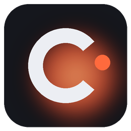
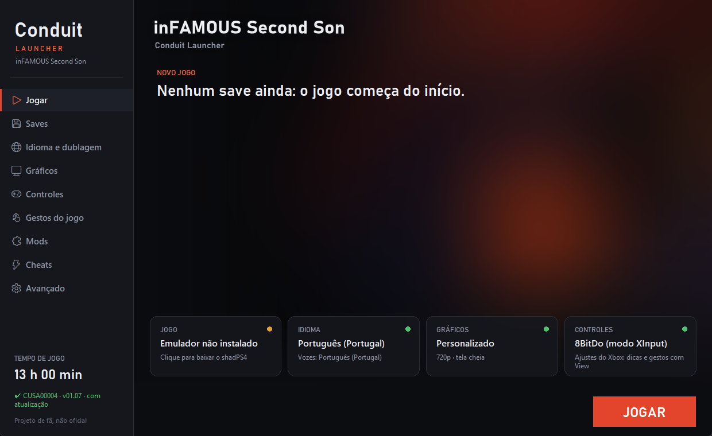

<p align="center"></p>

<h1 align="center">Conduit Launcher</h1>
<p align="center">Launcher <b>não oficial</b> para jogar <b>inFAMOUS Second Son</b> (PS4) no PC com o emulador shadPS4.</p>
<p align="center"><a href="README.md">English</a> · Português</p>

> **Projeto de fã, não oficial.** Não é afiliado à Sony Interactive Entertainment, à Sucker Punch Productions
> nem à equipe do shadPS4. **Nenhum arquivo do jogo vem com o launcher**: você precisa da sua própria cópia,
> extraída do seu console. Leia [LEGAL.md](LEGAL.md).



## O que ele faz

- **Instala o emulador com um clique**: o botão "Baixar / atualizar emulador" (ou o `baixar-emulador.bat`)
  baixa o shadPS4 "Infamous" direto do projeto original. Não precisa abrir nada.
- **Idioma e dublagem separados**: legendas em qualquer um dos 16 idiomas da versão europeia e vozes em
  qualquer um dos 11. **Português do Brasil** pode ser importado da sua cópia americana (CUSA00223).
- **Botões do Xbox nas dicas do jogo** e **gestos de touchpad no controle do Xbox** (View + botão). Os
  ajustes do Xbox só valem com controle do tipo Xbox; com DualShock 4 / DualSense o jogo usa o touchpad e o
  sensor do próprio controle. Ele detecta o controle sozinho e pergunta quando não consegue.
- **Tela "Gestos do jogo"**: tudo o que o jogo pede no touchpad e no sensor, com o que apertar.
- **Saves**: backup automático antes de cada sessão, restaurar, exportar/importar .zip e editor de save
  (karma, nível, copiar e apagar slot).
- **Mods de arrastar e soltar**: jogue um `.zip` na pasta `mods` e ele já é instalado.
- **Cheats** que ligam e desligam com o jogo aberto, cada um conferido com o seu executável do jogo.
- **Patches**: pular a abertura, sem desfoque de movimento, sem profundidade de campo, resolução interna.
- **Gráficos**: predefinições, FSR, nitidez, VSync, resolução.
- Atalho na Steam e na área de trabalho, tempo de jogo, teclado e mouse configuráveis.
- Interface em português (Brasil e Portugal) e inglês.

## Instalação

1. Baixe o `.zip` mais novo em **[Releases](../../releases)** e extraia numa pasta (ex.: `D:\Jogos\Conduit Launcher`).
2. Abra **Conduit Launcher.exe**. No quadro "Jogo", clique para **baixar o emulador** (cerca de 60 MB).
   Sem internet no PC? Rode `baixar-emulador.bat` em outro momento: ele faz o mesmo.
3. Clique em "Jogo" de novo e **escolha a pasta do jogo**, a que tem o `eboot.bin` (ex.: `CUSA00004`).
   A atualização (`CUSA00004-patch` ou `CUSA00004-UPDATE` ao lado) é usada sozinha.
4. Aperte **JOGAR**.

Versões aceitas: europeia **CUSA00004** (recomendada, tem todos os idiomas), americana CUSA00223 e
asiática CUSA00064. O jogo precisa estar extraído (pasta com `eboot.bin`), não em `.pkg`. O launcher não
instala `.pkg` de PS4: o conteúdo deles é criptografado com chaves da Sony, que este projeto não traz nem usa
(o próprio shadPS4 removeu o instalador de PKG).

## Tutorial

### Português do Brasil
A versão europeia tem português de Portugal. O PT-BR (legendas e dublagem) vem da versão americana:
1. Em **Idioma e dublagem**, clique em **Importar português do Brasil…**
2. Escolha a pasta da sua cópia americana (`CUSA00223`) ou de um port PT-BR já pronto para a versão europeia.
3. Escolha "Português (Brasil)" nas legendas e/ou nas vozes.

Os arquivos do jogo nunca são alterados: o launcher monta uma camada de mods à parte.

### Controles
| No jogo pede | Controle do Xbox | Teclado |
|---|---|---|
| Drenar poder (segurar o touchpad) | View (segurar) | F |
| Tocar para detalhes | View (toque) | F |
| Dois polegares | View + LB + RB | 9 + 0 + F |
| Deslizar para abrir portas | View + ↑ ↓ ← → | 1 2 3 4 |
| Scanner de digital | View + LB, mexa o analógico esquerdo | 9 + analógico |
| Núcleo móvel (arrastar para cima e segurar) | View + LT, segure (RT fica livre) | 9 + analógico ↑ |
| Sacudir a lata | View + A | T |
| Lata de lado | View + X / View + B | G / H |
| Mirar o spray | View + Y (modo spray), analógico direito | F6 + mouse |

Todas as teclas se trocam em **Controles**. No jogo: F8 recarrega os controles, F9 pausa, F10 mostra o FPS,
F11 tela cheia, Ctrl+Shift+End fecha.

### Mods (.zip)
- Arraste o `.zip` para a pasta **`mods`** do launcher (o botão "Abrir pasta" em **Mods** leva até ela).
  Na próxima vez que o launcher abrir ou que você der JOGAR, ele é instalado. Tirou o `.zip`, o mod sai.
- O tipo é reconhecido pelo conteúdo: dublagem/legendas, cheats (`.json`), patches (`.xml`), artes
  (`hero.png`, `logo.png`…) ou arquivos do jogo (mesmos caminhos do jogo, ex.: `art/cache/...`).
- Um `mod.json` opcional na raiz do zip dá nome e tipo:
  ```json
  { "name": "Meu mod", "description": "O que ele faz", "author": "Você", "type": "files" }
  ```
  `type`: `files`, `dub` (com `"lang": "ptbr"` ou `"ptpt"`), `cheats`, `patches` ou `art`.

### Cheats
Em **Cheats**, aperte **Baixar cheats** (lista do GoldHEN Cheat Repository). Ligue antes de jogar ou com o
jogo aberto: com o launcher aberto, eles mudam na hora. Um cheat feito para outra versão do jogo aparece
bloqueado.

### Saves
Os saves ficam em `emu\user\home\1000\savedata`. Antes de cada sessão é feito um backup em `user\backups`
(os últimos 20). Em **Saves** dá para restaurar, exportar, importar e **editar** um slot. O editor faz um
backup antes de gravar; o campo de fragmentos ainda é experimental.

## Dicas

- **Desempenho**: comece com a predefinição "Desempenho" (720p com FSR). Os primeiros minutos engasgam
  enquanto os shaders são compilados; depois fica liso.
- **Steam**: em Avançado, "Adicionar à Steam" cria o atalho com o Steam Input desligado, para o controle
  do Xbox chegar direto no jogo.
- **Controle do Xbox / 8BitDo**: use o modo XInput. O launcher mostra o controle detectado em Controles > Opções.
- **DualSense / DualShock 4**: funciona direto, com touchpad e giroscópio reais.

## Problemas comuns

| Problema | O que fazer |
|---|---|
| "Jogo não encontrado" | Escolha a pasta que tem `eboot.bin` dentro. |
| Tela preta ao abrir | Espere 1 a 2 minutos na primeira vez (shaders). Feche overlays (RTSS, OBS) se travar. |
| View não drena | Confira em Controles > Opções se o tipo de controle é "Xbox"; aperte F8 no jogo. |
| Menus em inglês com PT-BR | O texto americano não foi adaptado: use um port PT-BR pronto. |
| Algo deu errado | Avançado > "Ver log da última execução" e abra uma issue com ele. |

## Compilar

```bat
pip install -r requirements.txt
build.bat
```
Gera `dist\Conduit Launcher`. Ao publicar uma tag `v*`, o GitHub Actions compila e anexa o `.zip` ao Release.
Para conferir as traduções: `python tools\i18n_check.py`.

## Créditos e licença

Código do launcher: [MIT](LICENSE). Emulador, cheats, patches e artes são de seus autores e licenças:
veja [CREDITS.md](CREDITS.md) e [LEGAL.md](LEGAL.md).
